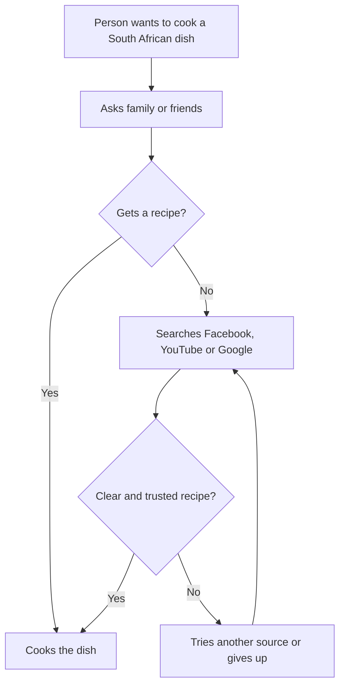
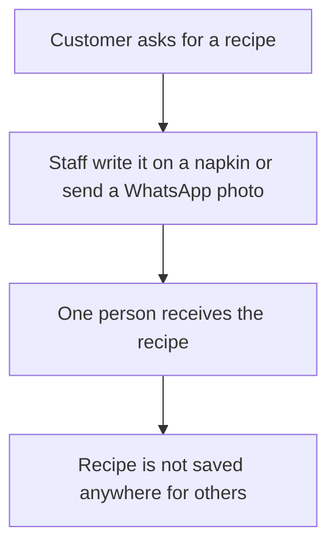

# Lab 1: Discovery

**Project:** Midlands Table
**Author:** Nkosinathi Emmanuel Ndlovu
**Date:** November 2026
**Status:** Complete

## 1. How the project started (fictional scenario)

In October 2026 I visited Ukudla Kitchen, a small restaurant in Pietermaritzburg that serves home-style KwaZulu-Natal food such as bunny chow, potjiekos and malva pudding.

The owner, Thandi Mkhize, told me that customers ask for her recipes all the time. Right now she writes them on napkins or sends photos of them on WhatsApp. Each recipe only reaches one person. She also told me that many young people around her want to cook the food they grew up with, but they cannot find a recipe they trust.

Thandi loves South African food and wants it shared, not kept secret. She asked whether a website could let anyone in the public find these recipes and use them. The website is not for selling the restaurant's food or taking orders. It is for the public.

## 2. Problem statement

People who want to cook South African dishes cannot easily find clear, trusted recipes in one place. Ukudla Kitchen has many good recipes, but it has no simple way to share them with the public, so they stay with the restaurant or travel one person at a time through photos and chats.

## 3. Business need and goals

**Business need:** A free public website where recipes are easy to find, easy to read on a phone, and easy to use for planning meals.

| ID | Goal | How we will know it is working |
| --- | --- | --- |
| G1 | Make recipes easy to find | A visitor reaches any recipe in three clicks or fewer |
| G2 | Make recipes easy to follow on a phone | A recipe can be read on a phone without zooming or side scrolling |
| G3 | Help people plan meals | A visitor can build a simple meal plan in under two minutes |
| G4 | Keep local food culture alive | The collection of KwaZulu-Natal and South African dishes keeps growing |
| G5 | Keep running costs low | Version 1 runs without monthly fees |

## 4. Stakeholders

| Stakeholder | Role | What they need | Influence | Interest |
| --- | --- | --- | --- | --- |
| Thandi Mkhize, owner of Ukudla Kitchen | Sponsor | Her recipes shared with the public and local food kept alive | High | High |
| Kitchen staff | Recipe providers | A simple way to write recipes down and keep them up to date | Medium | High |
| Home cooks | Main users | Clear recipes they can trust, in plain English | Medium | High |
| Young people learning to cook | Main users | Simple steps and ingredients that are easy to buy | Low | High |
| Families planning weekly meals | Main users | One place to collect the dishes they want to cook | Low | High |
| People using phones with limited data | Users | Pages that load fast and are light on data | Low | Medium |
| People who use screen readers or need larger text | Users | A site they can use with a keyboard and assistive tools | Low | High |
| Business analyst and developer | Delivery | Clear scope and requirements to build from | High | High |

## 5. Current situation

### How people find recipes today

### How the restaurant shares recipes today

### Pain points

| ID | Pain point |
| --- | --- |
| P1 | Recipes are spread across napkins, chats, social media and videos |
| P2 | Many online recipes use foreign ingredients or units that people do not use at home |
| P3 | Photos of recipes in chats cannot be searched or reused |
| P4 | Each shared recipe reaches only one person |
| P5 | There is no simple tool to collect a few dishes into a plan for the week |
| P6 | Heavy websites cost people with limited data too much to load |

## 6. Causes of the problem

| Problem | Cause |
| --- | --- |
| People cannot find trusted South African recipes | No single public place for them |
| Recipes do not spread | The restaurant shares them one person at a time |
| Recipes are hard to follow | Many are only a photo or a short message, with no clear ingredient list or steps |
| People struggle to plan meals | Recipe sources do not offer a simple meal plan |

## 7. Discovery findings (simulated)

The findings below were simulated for this project. They show the kind of results this discovery work would produce.

- Most people ask family first, then search online when they get no answer.
- Online recipes often use cups, ounces or ingredients that are hard to find locally.
- Recipes sent as photos are hard to find again later.
- People like to decide what they will cook for the week, but they have no simple tool for it.
- People on phones with limited data leave pages that load slowly.
- People who use screen readers need clear headings, labels and picture descriptions.

## 8. Scope

**In scope for version 1**
- A public recipe website
- Browsing recipes and opening a recipe to read it in full
- Pictures for recipes
- A simple meal plan
- A layout that works on phones
- Accessibility for keyboard and screen reader users

**Out of scope for version 1**
- Ordering food or taking payments
- Restaurant bookings or delivery
- User accounts and sign in
- Comments and ratings

## 9. Assumptions, constraints and risks

**Assumptions**
- Ukudla Kitchen provides the recipes and the photos.
- Visitors use a phone or computer with a web browser.
- The main language is plain English.
- There is no budget for hosting fees.

**Constraints**
- The website is a React web app.
- Version 1 has no database.
- Version 1 runs on free hosting.
- One person does the analysis, design and build.

**Risks**

| ID | Risk | Plan |
| --- | --- | --- |
| R1 | There are too few recipes at launch, or they go out of date | Start with the restaurant's best-known dishes and make adding recipes simple |
| R2 | Photos are used without permission | Only use photos the restaurant owns or has permission to use |
| R3 | People ask to submit their own recipes, which grows the scope | Keep this out of version 1 and list it as a later release |
| R4 | The site is hard to use with a screen reader or keyboard | Build for accessibility from the start and test with a screen reader |
| R5 | Pages are too heavy for people with limited data | Keep pages light and compress pictures |

## 10. Options and recommendation

| Option | Description |
| --- | --- |
| 1. Do nothing | Keep sharing recipes on napkins and WhatsApp |
| 2. Social media page | Post recipe photos on a Facebook or Instagram page |
| 3. Recipe website | Build a small public website where recipes are written out in full |

| Criteria | Option 1 | Option 2 | Option 3 |
| --- | --- | --- | --- |
| Reaches the public | No | Yes | Yes |
| Recipes are easy to search | No | Limited | Yes |
| Clear ingredients and steps | No | Limited | Yes |
| Meal planning | No | No | Yes |
| Restaurant owns the content | Yes | No | Yes |
| Running cost | None | None | Low |

**Recommendation:** Option 3. It is the only option that meets goals G1 to G3 and keeps the content owned by the restaurant.

**Decision:** The discovery work supports building the website. The project moves to Lab 2 to write the requirements.
