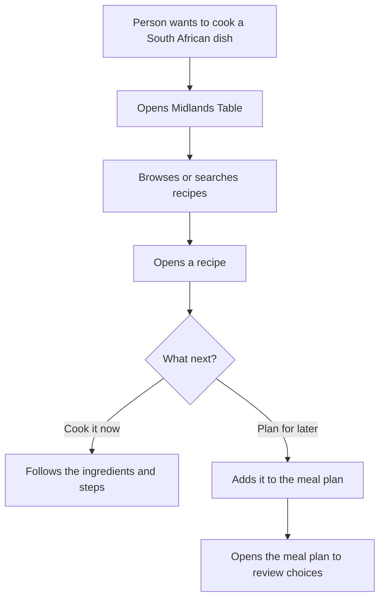

# Lab 2: Requirements

**Project:** Midlands Table
**Author:** Nkosinathi Emmanuel Ndlovu
**Date:** November 2026
**Status:** Complete, ready for build

## 1. Purpose

This document lists what the Midlands Table website must do. It builds on the problem, goals and scope in [Lab 1](../lab-1-discovery/discovery.md). Requirements are ranked with MoSCoW: **Must**, **Should**, **Could** and **Won't** (not in version 1).

## 2. User groups

| User | Description | Main need |
| --- | --- | --- |
| Sipho, a young person learning to cook | Wants to make the food he grew up with | Simple steps and ingredients that are easy to buy |
| Nomsa, a busy parent | Plans the family's meals for the week | One place to collect the dishes she will cook |
| Thandi, the restaurant owner | Provides the recipes | A simple way to add and update recipes |

All three names are fictional.

## 3. Functional requirements

| ID | Requirement | Priority |
| --- | --- | --- |
| FR-01 | The site has a home page that explains what Midlands Table is and links to the recipes | Must |
| FR-02 | Visitors can browse a list of recipes, where each one shows a name, a picture and a short description | Must |
| FR-03 | Visitors can open a recipe to see its ingredients, steps, preparation time, cooking time and number of servings | Must |
| FR-04 | Each recipe has a picture with a text description for people who cannot see it | Must |
| FR-05 | Visitors can add a recipe to their meal plan | Must |
| FR-06 | Visitors can see all the recipes in their meal plan on one page | Must |
| FR-07 | Visitors can remove a recipe from their meal plan | Must |
| FR-08 | Visitors can move between the home page, recipe list, recipe page and meal plan without the whole site reloading | Must |
| FR-09 | The site shows a clear message when there is nothing to show, such as an empty meal plan or a page that does not exist | Must |
| FR-10 | Visitors can search recipes by name | Should |
| FR-11 | Visitors can filter recipes by category, such as mains or desserts | Should |
| FR-12 | The meal plan is still there when the visitor refreshes the page | Should |
| FR-13 | The meal plan shows one combined list of ingredients | Could |
| FR-14 | Visitors can send in their own recipe for the restaurant to review | Could |
| FR-15 | Visitors can share a link to a recipe | Could |
| FR-16 | User accounts, comments, ratings, payments and food ordering | Won't |

## 4. Non-functional requirements

| ID | Requirement | Measure |
| --- | --- | --- |
| NFR-01 | The site works on phones and computers | Usable from a 320 pixel wide screen up, with no side scrolling |
| NFR-02 | The site can be used with a keyboard and a screen reader | Meets the WCAG 2.1 AA guidelines, with clear headings, labels and colour contrast |
| NFR-03 | Pages load quickly | Pages open in under three seconds on a mobile connection |
| NFR-04 | The site works in common browsers | Latest versions of Chrome, Edge, Firefox and Safari |
| NFR-05 | Content is written in plain English with units people use | Grams, millilitres, teaspoons and tablespoons, and local ingredient names |
| NFR-06 | New recipes can be added without changing the page code | Recipes are kept in a separate data file |
| NFR-07 | The site is cheap to run | Runs on free hosting |

## 5. User stories and acceptance criteria

**US-01 Browse recipes (FR-02, FR-03)**
As a home cook, I want to browse recipes so that I can find a dish to cook.
- Given I am on the recipe list, when the page loads, then I see recipes with a name, picture and short description.
- Given I select a recipe, when the page opens, then I see its ingredients, steps, times and servings.

**US-02 See pictures (FR-04)**
As a visitor, I want every recipe to have a picture so that I know what the dish looks like.
- Given I open a recipe, then I see a picture with a text description that a screen reader can read.

**US-03 Add to a meal plan (FR-05)**
As a parent planning the week, I want to add recipes to a meal plan so that I can decide what to cook.
- Given I am viewing a recipe, when I choose to add it, then it appears in my meal plan.

**US-04 View the meal plan (FR-06, FR-09)**
As a parent, I want to see my meal plan on one page so that I can check my choices.
- Given I have added recipes, when I open the meal plan, then I see all of them.
- Given I have added nothing, when I open the meal plan, then I see a message that it is empty with a link to the recipes.

**US-05 Remove from the meal plan (FR-07)**
As a parent, I want to remove a recipe so that I can change my mind.
- Given a recipe is in my meal plan, when I remove it, then it no longer appears.

**US-06 Move around the site (FR-08, FR-09)**
As a visitor, I want to move between pages quickly so that I do not wait for the whole site to reload.
- Given I select a link in the menu, when the page changes, then the new page appears without a full reload.
- Given I go to an address that does not exist, then I see a message that the page was not found and a link back home.

**US-07 Search and filter (FR-10, FR-11)**
As a young cook, I want to search and filter so that I can find a dish quickly.
- Given I type part of a recipe name, then only matching recipes are shown.
- Given I choose a category, then only recipes in that category are shown.

**US-08 Use the site on a phone (NFR-01, NFR-03)**
As a person using a phone, I want pages that fit my screen and load fast.
- Given I open any page on a 320 pixel wide screen, then I can read it without zooming or scrolling sideways.

**US-09 Use the site with assistive tools (NFR-02)**
As a person who uses a screen reader, I want clear headings and labels so that I can use the site.
- Given I use only a keyboard, then I can reach and use every link and button.
- Given I use a screen reader, then headings, buttons and pictures are read out clearly.

## 6. Business rules

| ID | Rule |
| --- | --- |
| BR-01 | Every recipe must have a name, a list of ingredients, steps and a number of servings |
| BR-02 | Recipes use metric units and the ingredient names used in South Africa |
| BR-03 | Pictures are only used when the restaurant owns them or has permission to use them |

## 7. Data requirements

**Recipe**

| Field | Description |
| --- | --- |
| id | A unique number for the recipe |
| name | The name of the dish |
| category | The type of dish, such as main or dessert |
| description | A short summary of the dish |
| image and image description | The picture and its text description |
| preparation time and cooking time | How long each part takes |
| servings | How many people the recipe feeds |
| ingredients | The list of ingredients with amounts |
| steps | The method in order |

**Meal plan**

| Field | Description |
| --- | --- |
| recipes | The recipes the visitor has added |

## 8. Future process

## 9. Technical constraints

- Midlands Table is a single-page React web app built with Vite.
- Moving between pages uses React Router.
- Styles are written with CSS Modules.
- Version 1 keeps recipe data inside the app, with no database.
- Version 1 runs on free hosting.

## 10. Assumptions, dependencies and risks

| Type | Item |
| --- | --- |
| Assumption | The restaurant supplies enough recipes and permitted photos to launch |
| Dependency | Recipe content and pictures must be ready before the site is published |
| Risk | Requests for user-submitted recipes (FR-14) may grow the scope, so they stay out of version 1 |
| Risk | Large pictures may slow the pages, so pictures are compressed |

## 11. Traceability

| Goal | Requirements | Part of the app |
| --- | --- | --- |
| G1 Make recipes easy to find | FR-01, FR-02, FR-08, FR-10, FR-11 | Home page, recipe list, search and filter, page navigation |
| G2 Make recipes easy to follow on a phone | FR-03, FR-04, NFR-01, NFR-03 | Recipe page, responsive styles, pictures |
| G3 Help people plan meals | FR-05, FR-06, FR-07, FR-09, FR-12 | Meal plan page |
| G4 Keep local food culture alive | FR-02, FR-03, BR-02 | Collection of KwaZulu-Natal and South African dishes |
| G5 Keep running costs low | NFR-06, NFR-07 | Recipe data file, free hosting |

## 12. Handover to build

| Item | Status |
| --- | --- |
| Problem and goals agreed (Lab 1) | Done |
| Scope for version 1 set: all Must requirements | Done |
| Requirements and acceptance criteria written | Done |
| Ready for build | Yes |

Version 1 is built as the [Midlands Table React app](https://github.com/nkosinathisya10/react-recipe-app).
